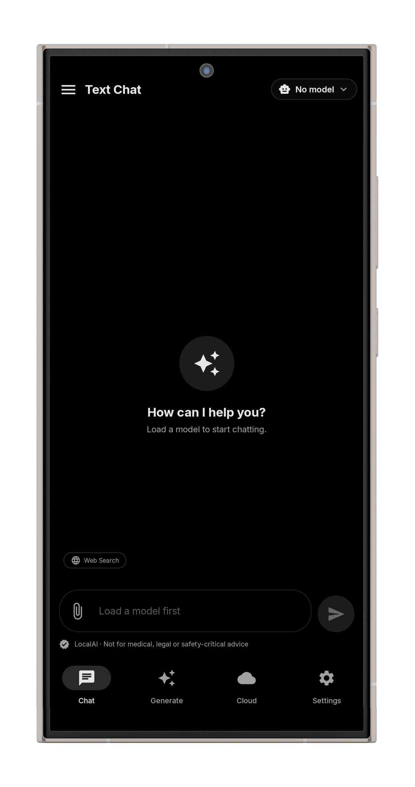
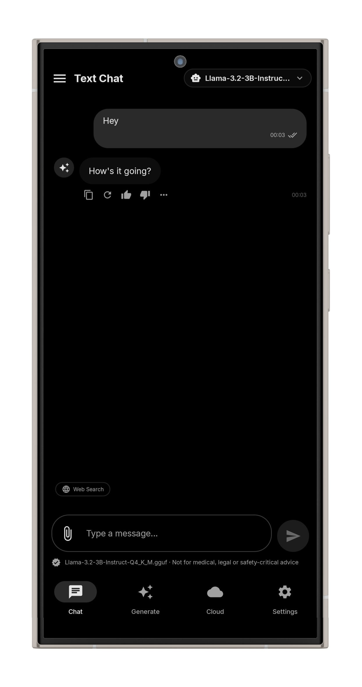
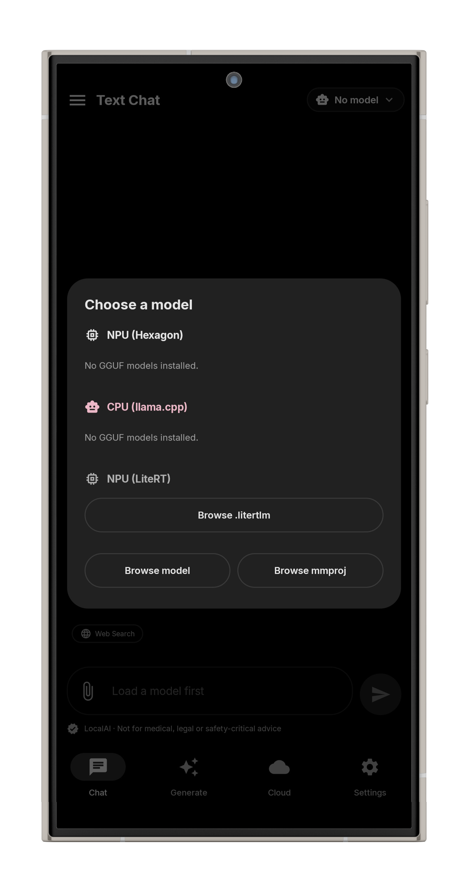
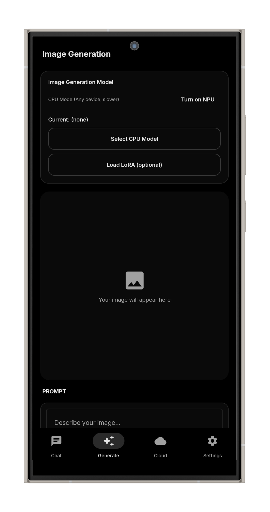
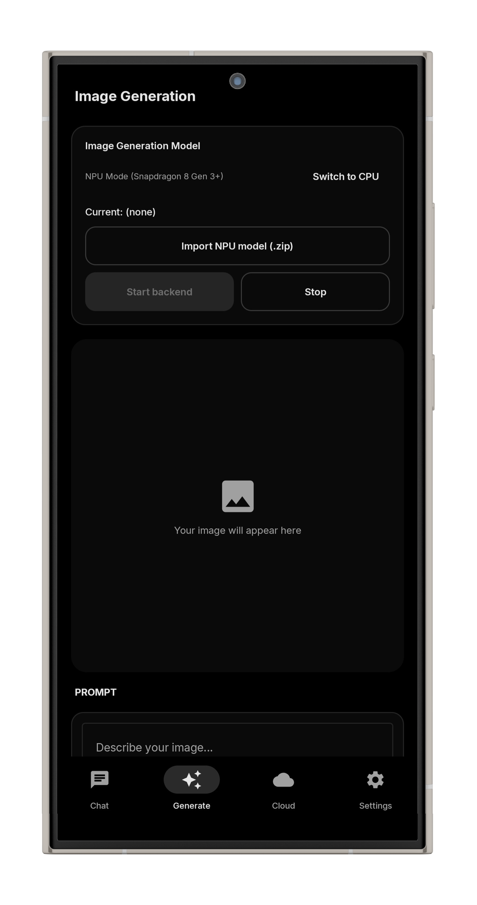
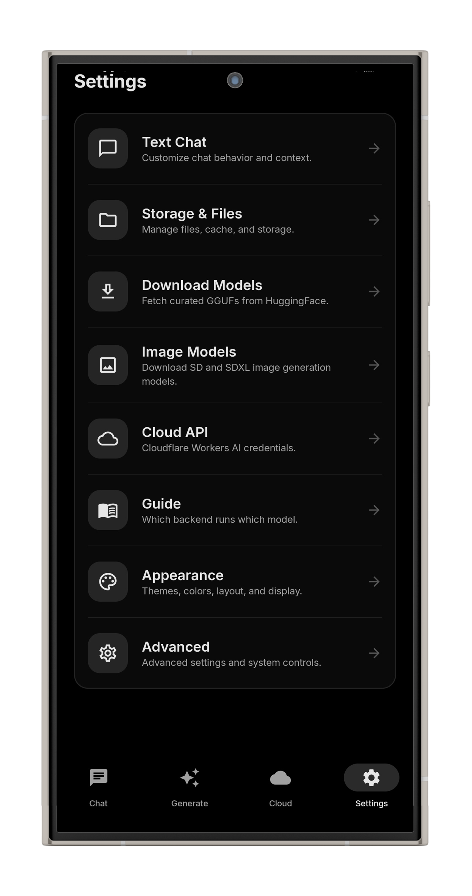
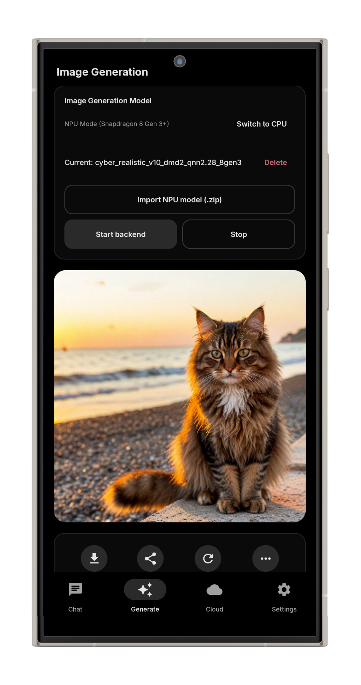
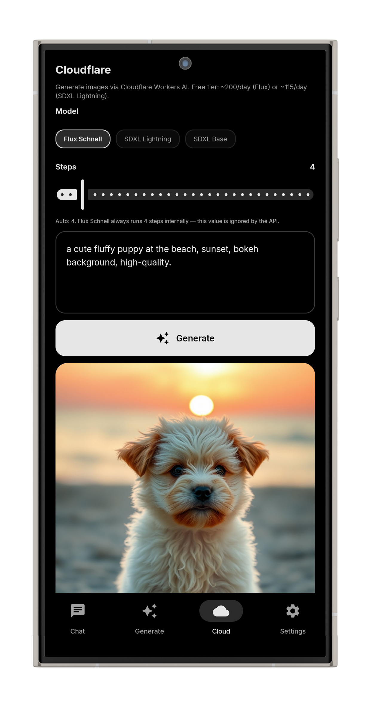

# LocalAI - Your On-Device AI Powerhouse

An advanced, fully offline AI application for Android. LocalAI runs entirely on your device — **no internet, no data leaving your phone**. It leverages hardware acceleration (CPU & NPU) to run Large Language Models (LLMs), Vision models, and Image Generation.

## ✨ Key Features

### 💬 Text Chat Backends
- **CPU (llama.cpp):** Works on every Android phone. Supports any GGUF model. Slowest but always reliable.
- **NPU (Hexagon):** Optimized for Snapdragon 8 Gen 2+. Best with Qwen-family GGUFs (Q4_0 / Q4_K_M). *Other architectures may fall back to CPU.*
- **NPU (LiteRT):** Designed for Snapdragon 8 Gen 3+. Runs Google `.litertlm` bundles only. Fastest inference and supports image input (Vision).

### 🎨 Image Generation Backends
- **CPU Models:** Uses the MNN format. Works on any phone (approx. 30–90 seconds per image).
- **NPU Models:** Optimized for Snapdragon 8 Gen 3+. Supports SDXL at 1024x1024. *DMD2 variants run in just 6 steps instead of 20+.*
- **Cloudflare (Cloud tab):** Generate images via Cloudflare Workers AI (requires API token in Settings). Includes ~200 free images/day.

### 🌐 Smart Web Search
- Integrated **Tavily-powered** search. Results are injected as context before the AI replies. Toggle it via the Web Search chip above the input bar.

### 📂 Smart File Parsing & History
- Attach and analyze text, markdown, CSV, logs, JSON, XML, and code files (`.kt`, `.py`, `.js`, `.rs`, etc.).
- Save, load, and manage multiple chat threads locally.
- The app intelligently only lists models your specific device hardware can actually run.

## 📸 Screenshots

  
  
  

 

  
  
  

 

  
  
  

## 🛠️ Tech Stack
- **Language:** Kotlin
- **UI Framework:** Jetpack Compose (Material 3)
- **Architecture:** MVVM + Hilt (Dependency Injection)
- **Native Backends:** `llama.cpp` (CPU), Hexagon SDK (NPU), LiteRT (NPU), MNN (Image Gen), `stable-diffusion.cpp`.
- **Networking:** Cloudflare Workers AI API, Tavily API.

## 🚀 Getting Started
1. Go to the [Releases](https://github.com/faihabib/Local-AI/releases) page and download the latest `LocalAI-release.apk`.
2. Install the APK on your Android device.
3. Open the app and navigate to **Settings > Download Models** to fetch a model compatible with your hardware.
4. Load your model and start chatting!

## ⚠️ Disclaimer
LocalAI is not intended for medical, legal, or safety-critical advice. AI models can hallucinate; always verify important information.

## 🙏 Acknowledgements
- **[llama.cpp](https://github.com/ggerganov/llama.cpp):** For the incredible C++ LLM inference engine.
- **LocalDream, QuantaLLM, & AI Edge Gallery:** For architectural inspiration and UI/UX ideas.
